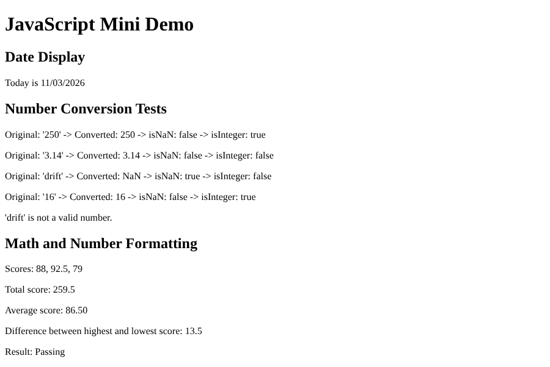

# JavaScript Mini Demo

COMP 484 - Homework 9: JavaScript Built-In Objects

## Built-In Objects and Methods Used

- `Date` object
  - `new Date()`
  - `getMonth()`
  - `getDate()`
  - `getFullYear()`
- `Number` object
  - `Number()`
  - `Number.isNaN()`
  - `Number.isInteger()`
  - `toFixed()`
- `String` object
  - `String()`
  - `padStart()`
- `document`
  - `getElementById()`
  - `innerHTML`

## GitHub Pages Link

https://jzxfan.github.io/comp484-hw9-ali/

## Screenshot

`screenshot.png`

## Reflection

The easiest part was the math section since adding and dividing the scores and using `toFixed(2)` was pretty straightforward. The hardest part was the date section because I had to remember that JavaScript months start at 0 and that the month and day need leading zeros to always show two digits. I learned that the `Date` object gives you separate methods for the month, day, and year, so you have to put the formatted string together yourself. With the `Number` object, I learned that `Number()` returns `NaN` for text that is not a number, and that `Number.isNaN()` and `Number.isInteger()` are useful for checking the result. I also learned that I can use `getElementById()` and `innerHTML` to put results right on the webpage instead of only showing them in the console.
